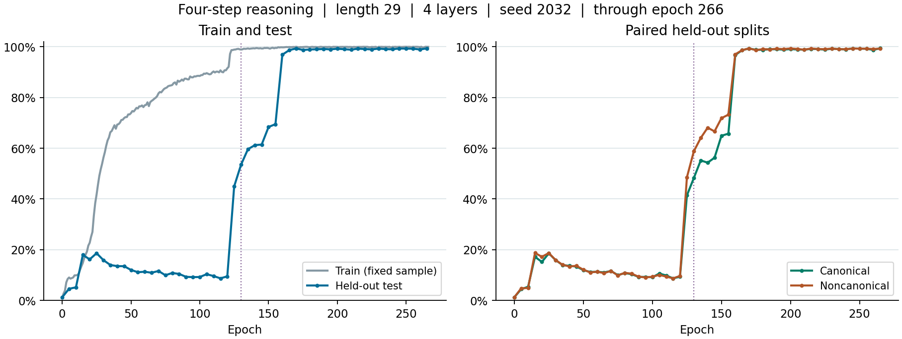

# 长度 29 的四步推理实验（第 4 组）

记录截至 2026-11-10 15:24:48+08:00。计划训练 500 轮，本次快照包含第 0 至 266 轮的训练记录。最近一次测试在第 265 轮，总测试准确率为 **99.350%**（19870/20000）。

## 模型和训练参数

| 项目 | 设置 |
|---|---|
| 任务 | 一条连续的 14 对事实链，以末尾查询词元为起点作 4 步推理 |
| 模型 | 4 层单头因果 Transformer，dm=1024，dff=2048，ReLU，Pre-RMSNorm，位置嵌入可学习 |
| 输入与词典 | 序列长度 29，词典大小 101，事实词元取值 20–100 |
| 数据 | 8,000,000 条固定训练样本；测试集为 10,000 对共享事实、查询和答案的 canonical / noncanonical 排列 |
| 种子 | 训练 2032，数据生成和固定训练评估样本均为 2027 |
| 优化器 | AdamW，β₁=0.9，β₂=0.999，ε=1e-8，weight decay=0.15 |
| 学习率 | 峰值 1e-4，前 20 轮线性 warmup，此后按原定 500 轮计划做余弦衰减 |
| Batch 与更新 | 全局 batch=2,000，每轮更新 4,000 次 |
| 精度 | FP32，关闭 TF32，启用 torch.compile |
| 并行 | 第 0–130 轮使用 4 张 RTX 4080，从第 130 轮 checkpoint 恢复后使用 8 张。每卡 batch 从 500 改为 250 |
| 评估 | 每轮在固定 10,000 条训练样本上测准确率，每 5 轮在完整的 20,000 条测试样本上评估 |

[完整运行配置](config.json) · [最后一轮训练状态](status.json) · [逐轮准确率和训练 loss](accuracy.csv)

## 结果

| Epoch | 训练抽样准确率 | 总测试准确率 | Canonical | Noncanonical |
|---:|---:|---:|---:|---:|
| 120 | 91.50% | 9.450% | 9.29% | 9.61% |
| 125 | 98.88% | 44.955% | 41.38% | 48.53% |
| 150 | 99.44% | 68.370% | 64.90% | 71.84% |
| 155 | 99.58% | 69.465% | 65.72% | 73.21% |
| 160 | 99.78% | 96.875% | 96.72% | 97.03% |
| 170 | 100.00% | 99.340% | 99.31% | 99.37% |
| 210 | 99.92% | 98.850% | 98.85% | 98.85% |
| 265 | 99.99% | 99.350% | 99.40% | 99.30% |

竖虚线标记第 130 轮换卡位置。CSV 中的准确率为 0–1 之间的比例，未评估测试集的轮次留空。

## 注意力热图

第 210 轮的两张热图各展示一条序列。它们来自同一对测试样本（canonical 行 0、noncanonical 行 10000），共享查询 33 和答案 37。红框标记最后一个查询词元在该层权重最高的位置。

[Canonical 单序列](canonical_epoch210.png) · [Noncanonical 单序列](noncanonical_epoch210.png) · [同一 canonical 查询在五个 checkpoint 的变化](canonical_query_evolution.png)
