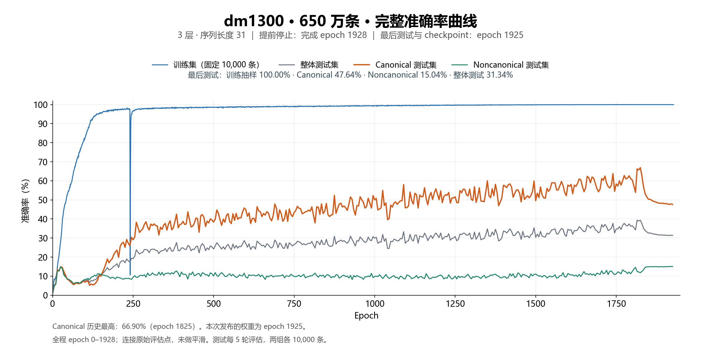

# dm=1300，dff=2600

3 层单头 Transformer，序列长度 31，固定训练集 **6,500,000 条**。原计划 2000 轮；2026-11-12 按要求提前停止，以启动另一组 800 万条实验。最后完成第 **1928** 轮，在第 1929 轮中途停止；最后测试及完整 checkpoint 均为第 **1925** 轮。

| 评估口径 | 轮次 | 固定训练样本 | 总测试集 | Canonical | Noncanonical |
|---|---:|---:|---:|---:|---:|
| 最后完整 checkpoint / 最后测试 | 1925 | 100.00% | 31.34% | 47.64% | 15.04% |
| 最后完成的训练评估 | 1928 | 100.00% | 未评估 | 未评估 | 未评估 |
| Canonical 历史最高 | 1825 | 100.00% | 39.36% | 66.90% | 11.82% |

训练准确率来自固定抽取的 10,000 条训练样本。Canonical 与 noncanonical 各 10,000 条，按同一事实链、查询和答案配对，只改变事实排列。本次发布包含第 1925 轮权重；不包含第 1825 轮权重。800 万条新实验的结果未混入本页。



[完整逐轮准确率和训练 loss](results/accuracy.csv) · [矢量曲线](results/accuracy.svg) · [完整配置](results/config.json) · [停止状态](results/status.json) · [续训日志：epoch 1575 之后](results/train_resume1575.log) · [较早训练日志](results/train.log)

## 超参数与复现

dm=1300，dff=2600，3 层，单头因果注意力，长度 31，词典大小 101。训练集 650 万条，全局 batch 4000，4 卡 DDP，FP32，关闭 TF32。AdamW，weight decay=0.15，峰值学习率 1e-4，20 轮 warmup，随后沿原定 2000 轮计划做余弦衰减。训练 seed=2031，数据 seed=2027。

本轮续训使用的代码见 [source_at_resume/](source_at_resume/)。第 1925 轮 checkpoint 包含模型、AdamW 状态、配置和 epoch；其元数据与 SHA-256 见 [checkpoint_epoch1925.json](results/checkpoint_epoch1925.json)。

如需从该 checkpoint 继续训练，先将下载文件保存为指定输出目录中的 `latest.pt`，再运行：

```bash
CUDA_VISIBLE_DEVICES=0,1,2,3 RUN_DIR=/path/to/resume1925 bash resume_epoch1925.sh
```

该脚本保留原来的 650 万条数据和余弦学习率计划；从头复现原实验仍可运行 `bash train.sh`。

## 已保存的 checkpoint

[下载第 1925 轮 checkpoint 与本次结果归档](https://github.com/qt336/multi-reasoning/releases/tag/dm1300-len31-6p5m-stopped-20261112)

| 轮次 | 原始 PyTorch 文件 | 大小 |
|---:|---|---:|
| 30 | [dm1300-epoch-000030.pt](https://github.com/qt336/multi-reasoning/releases/download/len31-four-step-seed2031/dm1300-epoch-000030.pt) | 468.0 MiB |
| 31 | [dm1300-epoch-000031.pt](https://github.com/qt336/multi-reasoning/releases/download/len31-four-step-seed2031/dm1300-epoch-000031.pt) | 468.0 MiB |
| 32 | [dm1300-epoch-000032.pt](https://github.com/qt336/multi-reasoning/releases/download/len31-four-step-seed2031/dm1300-epoch-000032.pt) | 468.0 MiB |
| 33 | [dm1300-epoch-000033.pt](https://github.com/qt336/multi-reasoning/releases/download/len31-four-step-seed2031/dm1300-epoch-000033.pt) | 468.0 MiB |
| 35 | [dm1300-epoch-000035.pt](https://github.com/qt336/multi-reasoning/releases/download/len31-four-step-seed2031/dm1300-epoch-000035.pt) | 468.0 MiB |
| 380 | [dm1300-epoch-000380.pt](https://github.com/qt336/multi-reasoning/releases/download/len31-four-step-seed2031/dm1300-epoch-000380.pt) | 468.0 MiB |
| 1575 | [dm1300-epoch-001575.pt](https://github.com/qt336/multi-reasoning/releases/download/len31-four-step-seed2031/dm1300-epoch-001575.pt) | 468.0 MiB |
| 1925 | [dm1300-epoch-001925.pt](https://github.com/qt336/multi-reasoning/releases/download/dm1300-len31-6p5m-stopped-20261112/dm1300-epoch-001925.pt) | 468.0 MiB |

第 380 轮为迁移时保存的 checkpoint。第 1575 轮之后的续训保留了完整评估记录至第 1928 轮。[文件大小、下载地址与 SHA-256](checkpoints.csv)

## 历史注意力与评估

下列热图和测试 loss 仍是此前归档的诊断数据，不代表第 1925 轮。

[Canonical 单序列热图](diagnostics/latest_attention/attention_single_can_all.png) · [Noncanonical 单序列热图](diagnostics/latest_attention/attention_single_noncan_all.png) · [历次热图索引](diagnostics/attention_index.csv) · [测试 loss 原始记录](diagnostics/test_loss_history.json)

热图索引中的 `archive` 列对应 Release 附件名。解压后按 `attention/<snapshot>/` 查找同一轮的图片与指标。`initial` 和 `final` 分别对应迁移前后的保存位置，两份归档在交接处可能有相同轮次。

[自然逻辑顺序测试（第 1575 轮）](diagnostics/supplementary/dm1300_natural_order_epoch1575_20261107/result.json) · [值匹配分析（第 105 轮）](diagnostics/supplementary/value_matching_dm1300_20261028_1234/metrics.json) · [值匹配分析（第 145 轮）](diagnostics/supplementary/value_matching_dm1300_20261028_202611/metrics.json)

[训练源代码](source_at_launch/) · [可移植启动脚本](train.sh) · [原始训练机启动脚本](original_launch/)
