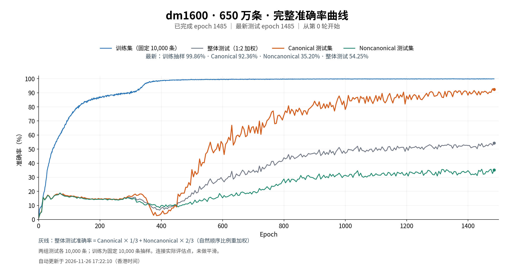
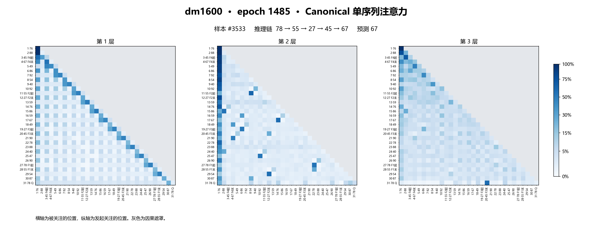

# dm1600 固定学习率分支 · 第 1485 轮

三层单头模型在长度 31 的序列上完成四步推理。训练集共 650 万条。模型宽度为 1600，FFN 宽度为 3200，全局 batch 为 4000，AdamW weight decay 为 0.15。续训使用 4 张 RTX 4080，训练 seed 为 2031。第 1000 轮后学习率固定为 5.079334700599354e-5。

2026 年 11 月 26 日在第 1486 轮中途停止。最后完成的第 1485 轮同时保存了模型、优化器状态和测试结果。[下载 checkpoint](https://github.com/qt336/multi-reasoning/releases/download/dm1600-len31-hold-epoch1485/dm1600-epoch-001485.pt) · [GitHub Release](https://github.com/qt336/multi-reasoning/releases/tag/dm1600-len31-hold-epoch1485)

| 第 1485 轮指标 | 结果 |
|---|---:|
| 固定训练样本准确率 | 9,986 / 10,000（99.86%） |
| Canonical 测试准确率 | 9,236 / 10,000（92.36%） |
| Noncanonical 测试准确率 | 3,520 / 10,000（35.20%） |
| 整体测试准确率（canonical × 1/3 + noncanonical × 2/3） | 54.25% |
| 配对测试集直接合并的准确率 | 12,756 / 20,000（63.78%） |
| 训练交叉熵 | 0.006511 |

[含 1:2 加权整体测试准确率的 CSV](accuracy_reweighted.csv) 覆盖第 0 至 1485 轮，共 298 次测试。每轮记录训练抽样准确率，每 5 轮评估两种顺序。[原始 CSV](accuracy.csv) 保留原始计数、直接合并的测试准确率、训练 loss 与学习率。[训练进度日志](training_progress.jsonl.gz) 保存训练器输出的逐步进度记录。

[模型与训练配置](config.json) · [学习率设置](lr_schedule_change.json) · [续训时使用的源代码](source_at_resume/) · [数据文件校验值](dataset.sha256) · [固定训练样本索引](train_accuracy_sample_ids.npz) · [最终指标](summary.json)

## Canonical 样本 #3533 的注意力

四个事实对分布在序列的第 2、6、10 和 14 个事实槽位。推理链为 78 → 55 → 27 → 45 → 67，模型预测 67。第二层 F3 末（位置 20）对 F4 末后一个 token（位置 5）的注意力为 11.47%。[单样本三层矩阵及输入序列](attention_3533.json)

